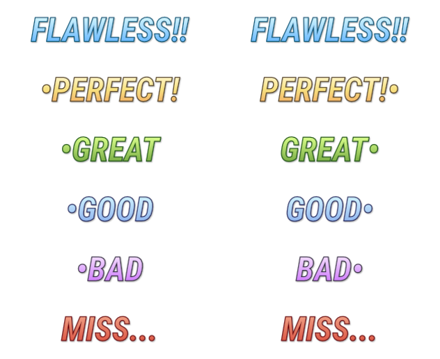

# StepMania judgment graphic and animation (roadmap #7)

> Verbatim excerpts from the StepMania 5 source that RhythmPad7 ports (`stepmania-pcapp/`, not in git).
> StepMania is (c) Chris Danford, the StepMania development team, et al.; sm-ssc additions (c) the spinal shark collective.
> Both are under an MIT-style license reproduced in full in `LICENSE-StepMania.txt` in this folder.
> Excerpts are unmodified; only the surrounding notes are RhythmPad7's.


## Sprite sheet

`assets/judgment-normal-2x6.png` here is a copy of `Themes/default/Graphics/Judgment Normal 2x6.png`: **2 columns × 6 rows**. Rows top to bottom are W1 Flawless, W2 Perfect, W3 Great, W4 Good, W5 Bad, Miss. The left column is shown for early steps and the right for late ones (the dot sits on the opposite side). To use it in the app, copy it to `app/src/main/res/drawable-nodpi/sm_judgment_normal.png`.



## Which frame and which animation

`Themes/default/Graphics/Player judgment/default.lua` lines 1–232

```lua
local c;
local player = Var "Player";
local function ShowProtiming()
  if GAMESTATE:IsDemonstration() then
    return false
  else
    return GetUserPrefB("UserPrefProtiming" .. ToEnumShortString(player));
  end
end;
local bShowProtiming = ShowProtiming();
local ProtimingWidth = 240;
local function MakeAverage( t )
	local sum = 0;
	for i=1,#t do
		sum = sum + t[i];
	end
	return sum / #t
end

local tTotalJudgments = {};

local JudgeCmds = {
	TapNoteScore_W1 = THEME:GetMetric( "Judgment", "JudgmentW1Command" );
	TapNoteScore_W2 = THEME:GetMetric( "Judgment", "JudgmentW2Command" );
	TapNoteScore_W3 = THEME:GetMetric( "Judgment", "JudgmentW3Command" );
	TapNoteScore_W4 = THEME:GetMetric( "Judgment", "JudgmentW4Command" );
	TapNoteScore_W5 = THEME:GetMetric( "Judgment", "JudgmentW5Command" );
	TapNoteScore_Miss = THEME:GetMetric( "Judgment", "JudgmentMissCommand" );
};

local ProtimingCmds = {
	TapNoteScore_W1 = THEME:GetMetric( "Protiming", "ProtimingW1Command" );
	TapNoteScore_W2 = THEME:GetMetric( "Protiming", "ProtimingW2Command" );
	TapNoteScore_W3 = THEME:GetMetric( "Protiming", "ProtimingW3Command" );
	TapNoteScore_W4 = THEME:GetMetric( "Protiming", "ProtimingW4Command" );
	TapNoteScore_W5 = THEME:GetMetric( "Protiming", "ProtimingW5Command" );
	TapNoteScore_Miss = THEME:GetMetric( "Protiming", "ProtimingMissCommand" );
};

local AverageCmds = {
	Pulse = THEME:GetMetric( "Protiming", "AveragePulseCommand" );
};
local TextCmds = {
	Pulse = THEME:GetMetric( "Protiming", "TextPulseCommand" );
};

local TNSFrames = {
	TapNoteScore_W1 = 0;
	TapNoteScore_W2 = 1;
	TapNoteScore_W3 = 2;
	TapNoteScore_W4 = 3;
	TapNoteScore_W5 = 4;
	TapNoteScore_Miss = 5;
};
local t = Def.ActorFrame {};
t[#t+1] = Def.ActorFrame {
	LoadActor(THEME:GetPathG("Judgment","Normal")) .. {
		Name="Judgment";
		InitCommand=cmd(pause;visible,false);
		OnCommand=THEME:GetMetric("Judgment","JudgmentOnCommand");
		ResetCommand=cmd(finishtweening;stopeffect;visible,false);
	};
	LoadFont("Combo Numbers") .. {
		Name="ProtimingDisplay";
		Text="";
		InitCommand=cmd(visible,false);
		OnCommand=THEME:GetMetric("Protiming","ProtimingOnCommand");
		ResetCommand=cmd(finishtweening;stopeffect;visible,false);
	};
	LoadFont("Common Condensed") .. {
		Name="ProtimingAverage";
		Text="";
		InitCommand=cmd(visible,false);
		OnCommand=THEME:GetMetric("Protiming","AverageOnCommand");
		ResetCommand=cmd(finishtweening;stopeffect;visible,false);
	};
	LoadFont("Common Condensed") .. {
		Name="TextDisplay";
		Text=THEME:GetString("Protiming","MS");
		InitCommand=cmd(visible,false);
		OnCommand=THEME:GetMetric("Protiming","TextOnCommand");
		ResetCommand=cmd(finishtweening;stopeffect;visible,false);
	};
	Def.Quad {
		Name="ProtimingGraphBG";
		InitCommand=cmd(visible,false;y,32;zoomto,ProtimingWidth,16);
		ResetCommand=cmd(finishtweening;diffusealpha,0.8;visible,false);
		OnCommand=cmd(diffuse,Color("Black");diffusetopedge,color("0.1,0.1,0.1,1");diffusealpha,0.8;shadowlength,2);
	};
	Def.Quad {
		Name="ProtimingGraphWindowW3";
		InitCommand=cmd(visible,false;y,32;zoomto,ProtimingWidth-4,16-4);
		ResetCommand=cmd(finishtweening;diffusealpha,1;visible,false);
		OnCommand=cmd(diffuse,GameColor.Judgment["JudgmentLine_W3"]);
	};
	Def.Quad {
		Name="ProtimingGraphWindowW2";
		InitCommand=cmd(visible,false;y,32;zoomto,scale(PREFSMAN:GetPreference("TimingWindowSecondsW2"),0,PREFSMAN:GetPreference("TimingWindowSecondsW3"),0,ProtimingWidth-4),16-4);
		ResetCommand=cmd(finishtweening;diffusealpha,1;visible,false);
		OnCommand=cmd(diffuse,GameColor.Judgment["JudgmentLine_W2"]);
	};
	Def.Quad {
		Name="ProtimingGraphWindowW1";
		InitCommand=cmd(visible,false;y,32;zoomto,scale(PREFSMAN:GetPreference("TimingWindowSecondsW1"),0,PREFSMAN:GetPreference("TimingWindowSecondsW3"),0,ProtimingWidth-4),16-4);
		ResetCommand=cmd(finishtweening;diffusealpha,1;visible,false);
		OnCommand=cmd(diffuse,GameColor.Judgment["JudgmentLine_W1"]);
	};
	Def.Quad {
		Name="ProtimingGraphUnderlay";
		InitCommand=cmd(visible,false;y,32;zoomto,ProtimingWidth-4,16-4);
		ResetCommand=cmd(finishtweening;diffusealpha,0.25;visible,false);
		OnCommand=cmd(diffuse,Color("Black");diffusealpha,0.25);
	};
	Def.Quad {
		Name="ProtimingGraphFill";
		InitCommand=cmd(visible,false;y,32;zoomto,0,16-4;horizalign,left);
		ResetCommand=cmd(finishtweening;diffusealpha,1;visible,false);
		OnCommand=cmd(diffuse,Color("Red"));
	};
	Def.Quad {
		Name="ProtimingGraphAverage";
		InitCommand=cmd(visible,false;y,32;zoomto,2,7);
		ResetCommand=cmd(finishtweening;diffusealpha,0.85;visible,false);
		OnCommand=cmd(diffuse,Color("Orange");diffusealpha,0.85);
	};
	Def.Quad {
		Name="ProtimingGraphCenter";
		InitCommand=cmd(visible,false;y,32;zoomto,2,16-4);
		ResetCommand=cmd(finishtweening;diffusealpha,1;visible,false);
		OnCommand=cmd(diffuse,Color("White");diffusealpha,1);
	};
	InitCommand = function(self)
		c = self:GetChildren();
	end;

	JudgmentMessageCommand=function(self, param)
        -- Fix Player Combo animating when player successfully avoids a mine.
        local msgParam = param;
        MESSAGEMAN:Broadcast("TestJudgment",msgParam);
        --
		if param.Player ~= player then return end;
		if param.HoldNoteScore then return end;
		
		local iNumStates = c.Judgment:GetNumStates();
		local iFrame = TNSFrames[param.TapNoteScore];
		
		if not iFrame then return end
		if iNumStates == 12 then
			iFrame = iFrame * 2;
			if not param.Early then
				iFrame = iFrame + 1;
			end
		end
		

		local fTapNoteOffset = param.TapNoteOffset;
		if param.HoldNoteScore then
			fTapNoteOffset = 1;
		else
			fTapNoteOffset = param.TapNoteOffset; 
		end
		
		if param.TapNoteScore == 'TapNoteScore_Miss' then
			fTapNoteOffset = 1;
			bUseNegative = true;
		else
-- 			fTapNoteOffset = fTapNoteOffset;
			bUseNegative = false;
		end;
		
		if fTapNoteOffset ~= 1 then
			-- we're safe, you can push the values
			tTotalJudgments[#tTotalJudgments+1] = math.abs(fTapNoteOffset);
--~ 			tTotalJudgments[#tTotalJudgments+1] = bUseNegative and fTapNoteOffset or math.abs( fTapNoteOffset );
		end
		
		self:playcommand("Reset");

		c.Judgment:visible( not bShowProtiming );
		c.Judgment:setstate( iFrame );
		JudgeCmds[param.TapNoteScore](c.Judgment);
		
		c.ProtimingDisplay:visible( bShowProtiming );
		c.ProtimingDisplay:settextf("%i",fTapNoteOffset * 1000);
		ProtimingCmds[param.TapNoteScore](c.ProtimingDisplay);
		
		c.ProtimingAverage:visible( bShowProtiming );
		c.ProtimingAverage:settextf("%.2f%%",clamp(100 - MakeAverage( tTotalJudgments ) * 1000 ,0,100));
		AverageCmds['Pulse'](c.ProtimingAverage);
		
		c.TextDisplay:visible( bShowProtiming );
		TextCmds['Pulse'](c.TextDisplay);
		
		c.ProtimingGraphBG:visible( bShowProtiming );
		c.ProtimingGraphUnderlay:visible( bShowProtiming );
		c.ProtimingGraphWindowW3:visible( bShowProtiming );
		c.ProtimingGraphWindowW2:visible( bShowProtiming );
		c.ProtimingGraphWindowW1:visible( bShowProtiming );
		c.ProtimingGraphFill:visible( bShowProtiming );
		c.ProtimingGraphFill:finishtweening();
		c.ProtimingGraphFill:decelerate(1/60);
-- 		c.ProtimingGraphFill:zoomtowidth( clamp(fTapNoteOffset * 188,-188/2,188/2) );
		c.ProtimingGraphFill:zoomtowidth( clamp(
				scale(
				fTapNoteOffset,
				0,PREFSMAN:GetPreference("TimingWindowSecondsW3"),
				0,(ProtimingWidth-4)/2),
			-(ProtimingWidth-4)/2,(ProtimingWidth-4)/2)
		);
		c.ProtimingGraphAverage:visible( bShowProtiming );
		c.ProtimingGraphAverage:zoomtowidth( clamp(
				scale(
				MakeAverage( tTotalJudgments ),
				0,PREFSMAN:GetPreference("TimingWindowSecondsW3"),
				0,ProtimingWidth-4),
			0,ProtimingWidth-4)
		);
-- 		c.ProtimingGraphAverage:zoomtowidth( clamp(MakeAverage( tTotalJudgments ) * 1880,0,188) );
		c.ProtimingGraphCenter:visible( bShowProtiming );
		(cmd(sleep,2;linear,0.5;diffusealpha,0))(c.ProtimingGraphBG);
		(cmd(sleep,2;linear,0.5;diffusealpha,0))(c.ProtimingGraphUnderlay);
		(cmd(sleep,2;linear,0.5;diffusealpha,0))(c.ProtimingGraphWindowW3);
		(cmd(sleep,2;linear,0.5;diffusealpha,0))(c.ProtimingGraphWindowW2);
		(cmd(sleep,2;linear,0.5;diffusealpha,0))(c.ProtimingGraphWindowW1);
		(cmd(sleep,2;linear,0.5;diffusealpha,0))(c.ProtimingGraphFill);
		(cmd(sleep,2;linear,0.5;diffusealpha,0))(c.ProtimingGraphAverage);
		(cmd(sleep,2;linear,0.5;diffusealpha,0))(c.ProtimingGraphCenter);
	end;

};


```

## Animation commands (default theme overrides _fallback)

`Themes/default/metrics.ini` (lines 954, 955, 956, 957, 958, 959)

```ini
JudgmentW1Command=finishtweening;shadowlength,0;y,0;diffusealpha,1;zoom,0.9;smooth,0.05;zoom,0.75;sleep,0.8;smooth,0.1;zoomy,0.5;zoomx,1.3;diffusealpha,0;glowblink;effectperiod,0.05;effectcolor1,color("1,1,1,0");effectcolor2,color("1,1,1,0.25")
JudgmentW2Command=finishtweening;y,0;shadowlength,0;diffusealpha,1;zoom,0.9;smooth,0.05;zoom,0.75;sleep,0.5;smooth,0.1;zoomy,0.5;zoomx,2;diffusealpha,0
JudgmentW3Command=finishtweening;y,0;shadowlength,0;diffusealpha,1;zoom,0.9;smooth,0.05;zoom,0.75;sleep,0.5;smooth,0.1;zoomy,0.5;zoomx,2;diffusealpha,0
JudgmentW4Command=finishtweening;y,0;shadowlength,0;diffusealpha,1;zoom,0.9;smooth,0.05;zoom,0.75;sleep,0.5;smooth,0.1;zoomy,0.5;zoomx,2;diffusealpha,0
JudgmentW5Command=finishtweening;y,0;shadowlength,0;diffusealpha,1;zoom,0.75;vibrate;effectmagnitude,1,2,2;sleep,0.5;smooth,0.1;zoomy,0.5;zoomx,2;diffusealpha,0
JudgmentMissCommand=finishtweening;y,0;shadowlength,0;diffusealpha,1;zoom,0.75;y,-20;smooth,0.8;y,20;sleep,0.5;smooth,0.1;zoomy,0.5;zoomx,2;diffusealpha,0
```

## Judgment colors (used for result lines)

`Themes/default/Scripts/02 Colors.lua` lines 50–111

```lua
GameColor = {
    PlayerColors = {
        PLAYER_1 = color("#4B82DC"),
        PLAYER_2 = color("#DF4C47"),
		both = color("#FFFFFF"),
    },
    PlayerDarkColors = {
        PLAYER_1 = color("#16386E"),
        PLAYER_2 = color("#65110F"),
		both = color("#F5E1E1"),
    },
    Difficulty = {
        --[[ These are for 'Custom' Difficulty Ranks. It can be very  useful
        in some cases, especially to apply new colors for stuff you
        couldn't before. (huh? -aj) ]]
        Beginner    = color("#1AE0E4"),         -- Mint
        Easy        = color("#3ACF2A"),         -- Green
        Medium      = color("#CFC42A"),         -- Yellow
        Hard        = color("#CF502A"),         -- Orange
        Challenge   = color("#981F41"),         -- Plum
        Edit        = color("0.8,0.8,0.8,1"),   -- Gray
        Couple      = color("#ed0972"),         -- hot pink
        Routine     = color("#ff9a00"),         -- orange
        --[[ These are for courses, so let's slap them here in case someone
        wanted to use Difficulty in Course and Step regions. ]]
        Difficulty_Beginner = color("#1AE0E4"),     -- Mint
        Difficulty_Easy     = color("#2FA74D"),     -- Green
        Difficulty_Medium   = color("#CFC42A"),     -- Yellow
        Difficulty_Hard     = color("#CF502A"),     -- Orange
        Difficulty_Challenge    = color("#981F41"), -- Plum
        Difficulty_Edit     = color("0.8,0.8,0.8,1"),       -- gray
        Difficulty_Couple   = color("#ed0972"),             -- hot pink
        Difficulty_Routine  = color("#ff9a00")              -- orange
    },
    Stage = {
        Stage_1st   = color("#9d324e"),
        Stage_2nd   = color("#9d3262"),
        Stage_3rd   = color("#9d3280"),
        Stage_4th   = color("#9d329d"),
        Stage_5th   = color("#7b329d"),
        Stage_6th   = color("#52329d"),
        Stage_Next  = color("#52329d"),
        Stage_Final = color("#325c9d"),
        Stage_Extra1    = color("#B60052"),
        Stage_Extra2    = color("#FF499B"),
        Stage_Nonstop   = color("#9d324e"),
        Stage_Oni   = color("#9d3232"),
        Stage_Endless   = color("#9d3232"),
        Stage_Event = color("#9d324e"),
        Stage_Demo  = color("#9d324e")
    },
    Judgment = {
        JudgmentLine_W1     = color("#A0DBF1"),
        JudgmentLine_W2     = color("#F1E4A2"),
        JudgmentLine_W3     = color("#ABE39B"),
        JudgmentLine_W4     = color("#86ACD6"),
        JudgmentLine_W5     = color("#958CD6"),
        JudgmentLine_Held   = color("#FFFFFF"),
        JudgmentLine_Miss   = color("#F97E7E"),
        JudgmentLine_MaxCombo   = color("#ffc600")
    },
}
```
